# Threejs Sketches

I like making threejs sketches and showing them to people on the internet, but there was no one place where I can collect them all.

So, here I present to you all my dumping ground for threejs sketches.

Visit the site [here](https://sketches-sarlloc.vercel.app).

This project is made using typescript. But the sketches use a lot of glsl as well. 

### The current few sketches are:

> Will keep adding more and more with time.

|   |   |   |
|---|---|---|
| [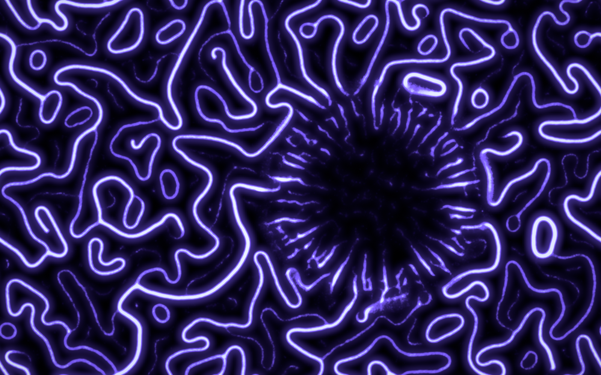](https://sketches-sarlloc.vercel.app/sketch/physarum) [Physarum](https://sketches-sarlloc.vercel.app/sketch/physarum) | [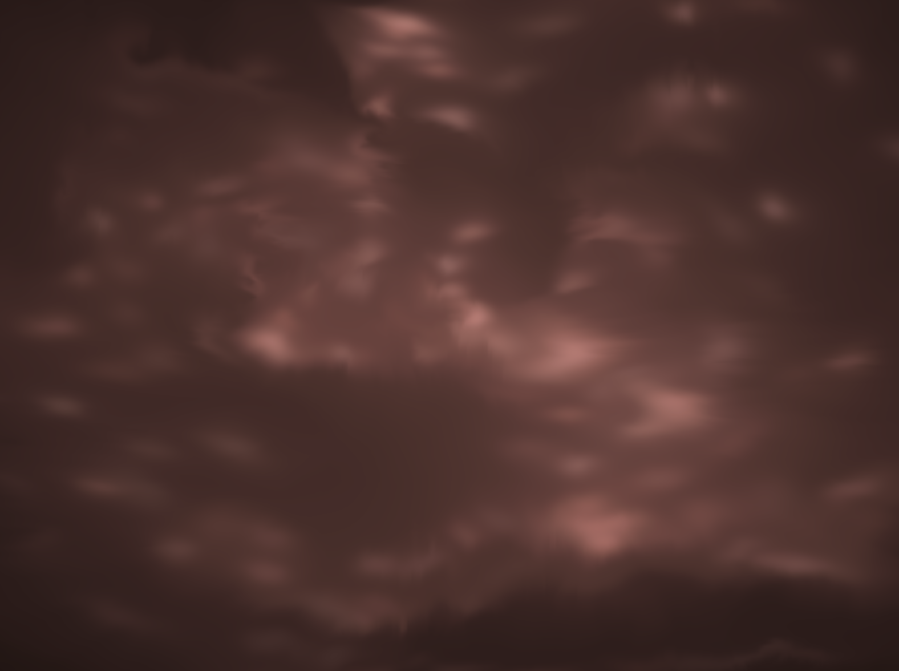](https://sketches-sarlloc.vercel.app/sketch/fluid-simulation) [Fluid](https://sketches-sarlloc.vercel.app/sketch/fluid-simulation) | [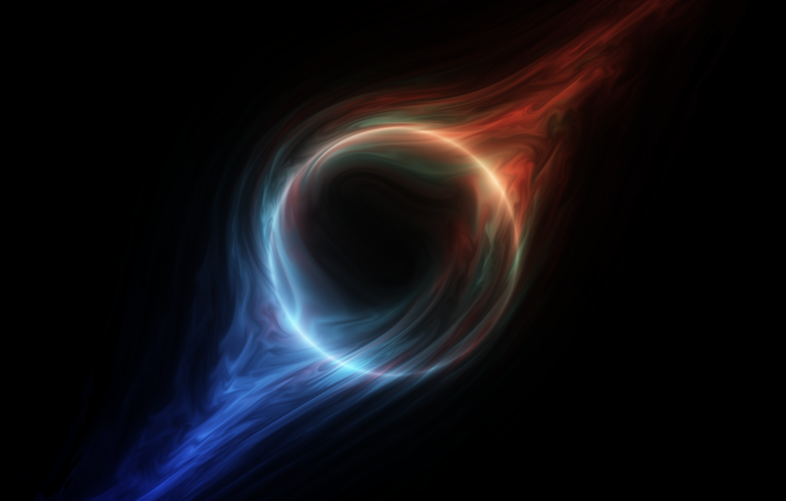](https://sketches-sarlloc.vercel.app/sketch/blackhole) [Black hole](https://sketches-sarlloc.vercel.app/sketch/blackhole) |
| [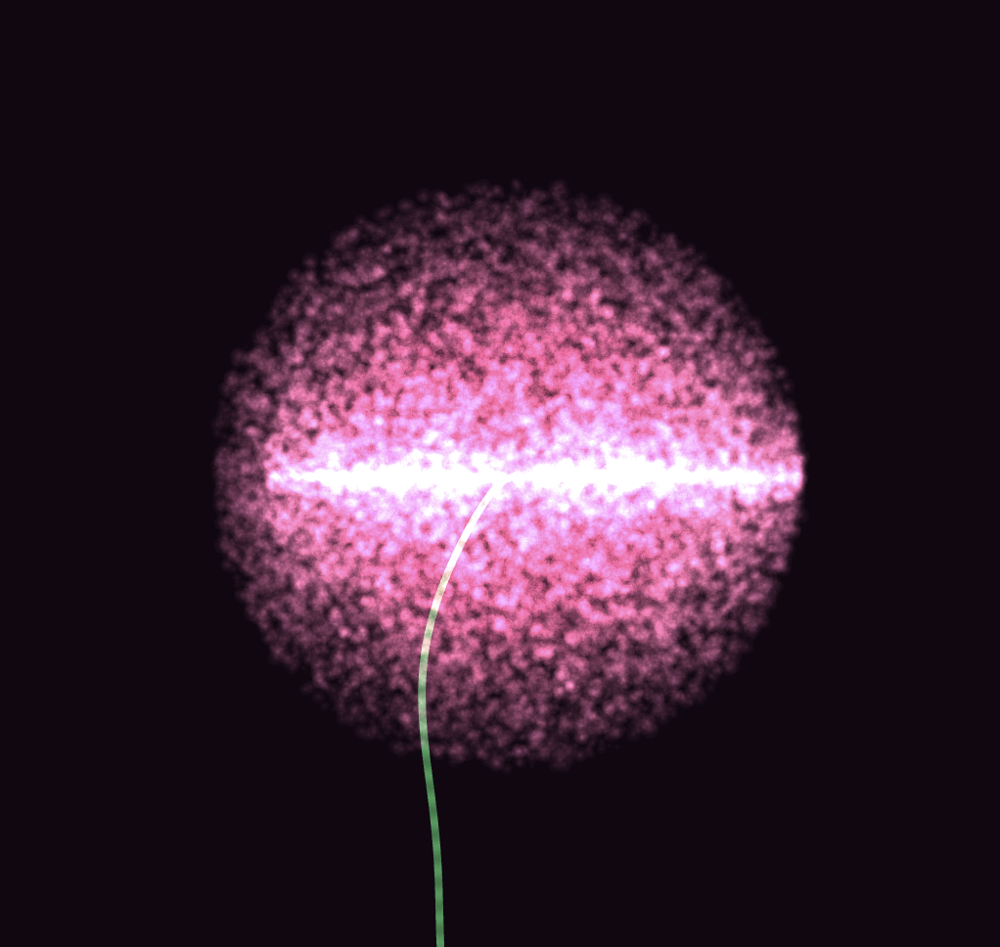](https://sketches-sarlloc.vercel.app/sketch/dandelions) [Dandelions](https://sketches-sarlloc.vercel.app/sketch/dandelions) | [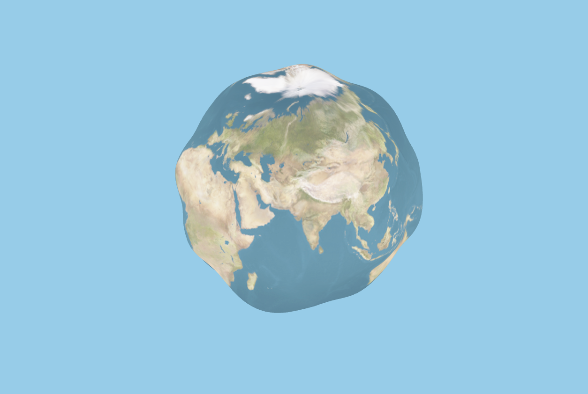](https://sketches-sarlloc.vercel.app/sketch/blobby-earth) [Blobby Earth](https://sketches-sarlloc.vercel.app/sketch/blobby-earth) | [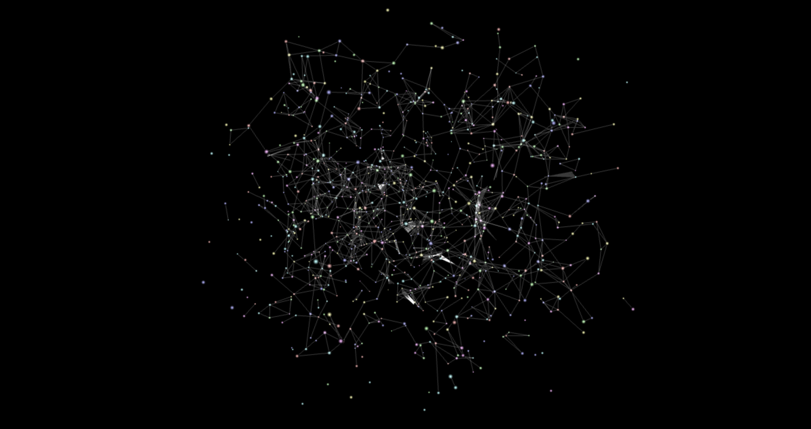](https://sketches-sarlloc.vercel.app/sketch/neurons) [Neurons](https://sketches-sarlloc.vercel.app/sketch/neurons) |
| [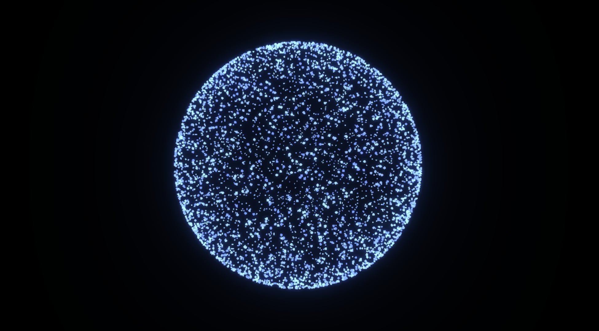](https://sketches-sarlloc.vercel.app/sketch/sparkling-sphere) [Sparkling Sphere](https://sketches-sarlloc.vercel.app/sketch/sparkling-sphere) | [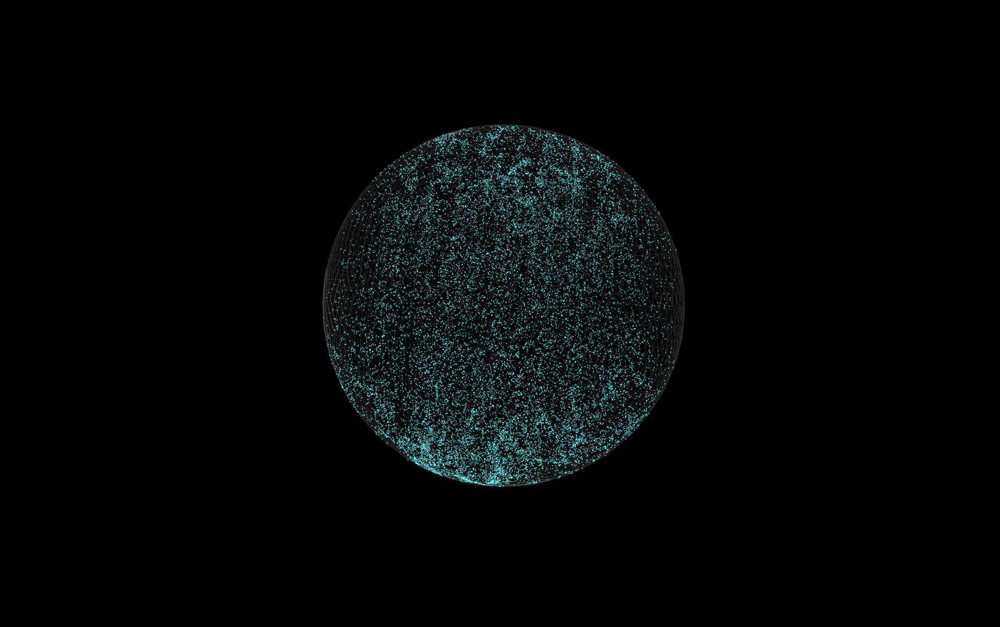](https://sketches-sarlloc.vercel.app/sketch/particle-sphere) [Particle Sphere](https://sketches-sarlloc.vercel.app/sketch/particle-sphere) | [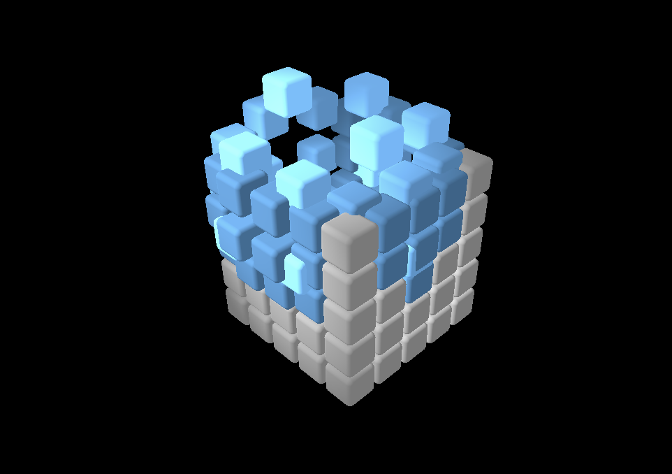](https://sketches-sarlloc.vercel.app/sketch/cubes) [Interactive Cubes](https://sketches-sarlloc.vercel.app/sketch/cubes) |
| [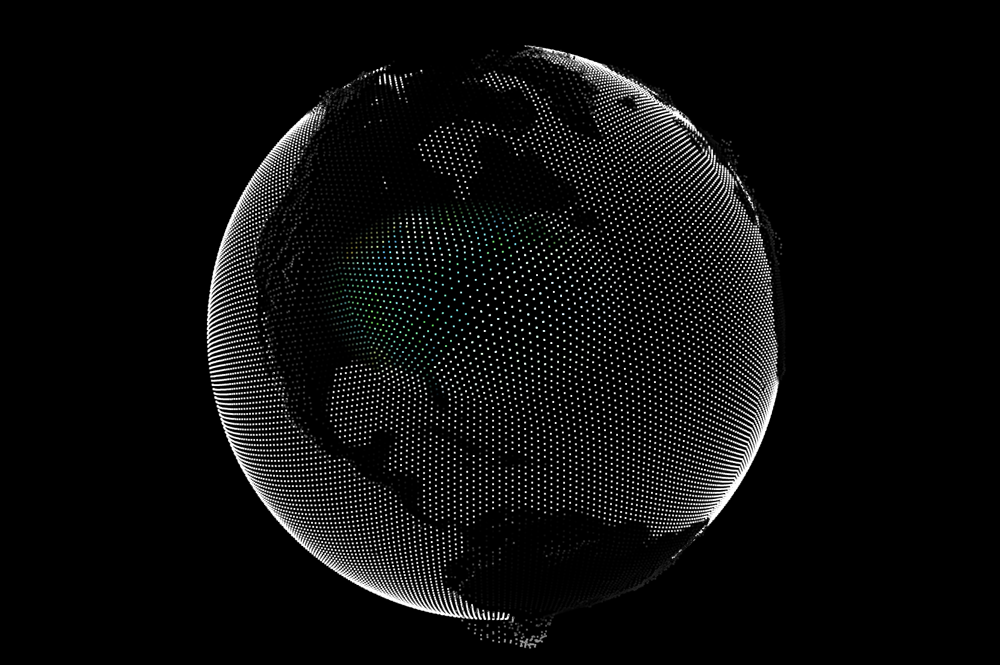](https://sketches-sarlloc.vercel.app/sketch/interactive-earth) [Interactive Earth](https://sketches-sarlloc.vercel.app/sketch/interactive-earth) | [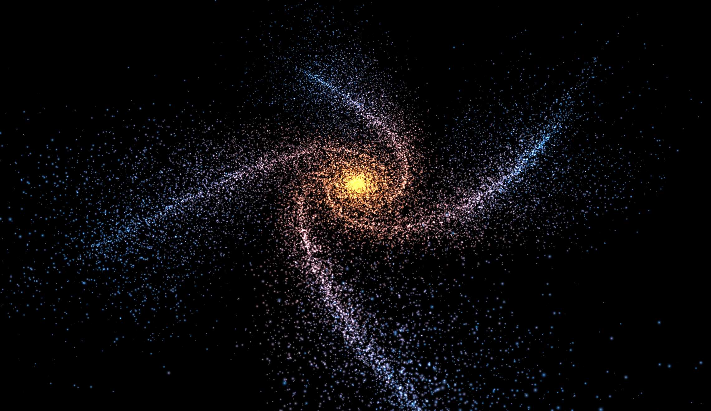](https://sketches-sarlloc.vercel.app/sketch/galaxy) [Galaxy](https://sketches-sarlloc.vercel.app/sketch/galaxy) | [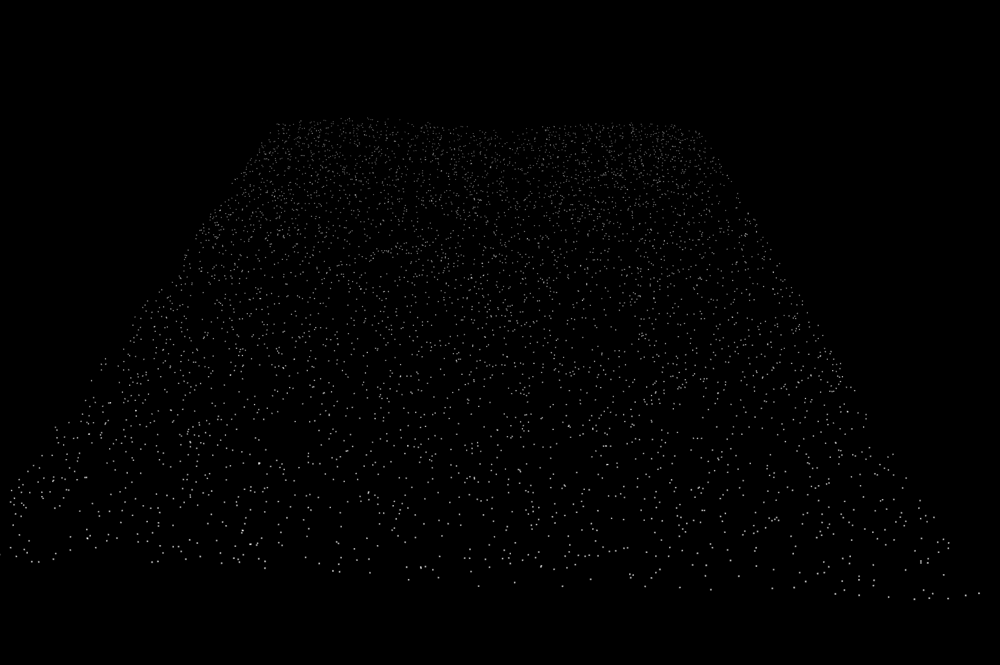](https://sketches-sarlloc.vercel.app/sketch/sparkling-particles) [Sparkling Particles](https://sketches-sarlloc.vercel.app/sketch/sparkling-particles) |

### Adding a sketch

Copy `src/sketches/_template` to `src/sketches/<name>`. The folder name becomes the URL, and the sketch shows up in the gallery on its own.

Then in the new folder:

- `meta.ts` has the title, description and so on. Give it the next `order` number above the current highest, which lists it first.
- Replace `thumbnail.png` with a screenshot of the sketch.
- Build the sketch in the `useThreeCanvas` callback. The hook looks after the renderer, the animation loop, resizing and cleaning up, so the sketch only describes its scene and what changes every frame.
